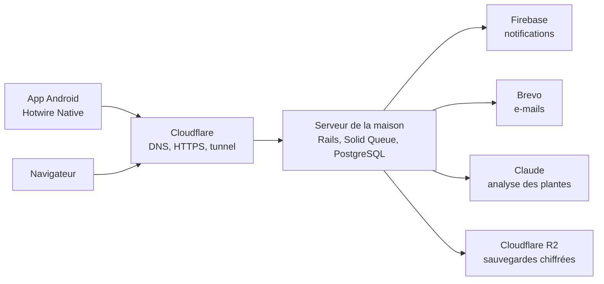

# Easy Home

**Toute la connaissance de la maison, partagée par le foyer.** Easy Home gère les tâches de la maison : ce qu'il faut
faire, quand, et comment. Dans un foyer, ce savoir est souvent dans la tête de celui qui s'en charge d'habitude : le
jour de la poubelle jaune, la dose de produit pour la piscine, l'endroit du filtre de la clim, la plante qui n'aime pas
trop d'eau. Dans Easy Home, il est écrit et partagé : n'importe quel membre du foyer peut prendre le relais.

Et rien n'est oublié : une tâche **reste ouverte tant qu'elle n'est pas faite**, une notification arrive **au bon
moment** (la veille au soir pour les poubelles), et un **journal** garde ce qui a été fait, par qui et quand.

> Tout a commencé par la poubelle jaune, collectée une semaine sur deux, que l'on oubliait. Projet personnel, fait pour
> un seul foyer, à La Réunion. Le code est public pour être lu ; l'app n'est pas un service ouvert : pas
> d'inscription, les comptes se créent sur le serveur.

## Ce que fait l'app

- **Aujourd'hui** : ce qui est à faire aujourd'hui et en retard, les tâches « à ne pas rater » en tête.
- **Les plantes** : inventaire, emplacements et exposition, suivi photo, arrosage par plante (la pluie du jour compte
  comme un arrosage). Une photo peut être **analysée par une IA** : espèce, état, actions conseillées, que l'on accepte
  une à une ; on peut ensuite poser des questions.
- **La maison** : tâches avec leur « Comment faire », poubelles à jour fixe, équipements (piscine, clim,
  lave-vaisselle…) et leur entretien, tâches « quand il le faut » (le sel), suggestions toutes prêtes.
- **Les rythmes** : une fois, tous les N jours / semaines / mois / ans après la dernière fois, à jour fixe (un mardi
  sur deux, chaque 1er novembre), ou sans échéance.
- **Les notifications** sur Android : un résumé chaque matin, et des rappels à une heure précise, relancés pour ce qui
  ne doit pas être raté.
- **Le journal** : ce qui a été fait, reporté ou manqué.

À venir : un animal, les membres du foyer et des invités aux droits limités (le voisin pendant les vacances), l'action
« Fait » directement depuis la notification. Détails : [la vision produit](docs/produit.md) et
[la roadmap](docs/roadmap.md).

## Ce que le projet explore

Au-delà du besoin du foyer, Easy Home est un terrain d'expérimentation sur trois sujets.

### Une app mobile sans réécrire l'interface

L'app Android est une **coque [Hotwire Native](https://native.hotwired.dev/)** : chaque écran est une page Rails
affichée dans une WebView, avec une navigation native (onglets, transitions, retour). Le Kotlin reste de la plomberie :
la logique vit dans Rails. Quelques éléments natifs sont pilotés par les pages (bouton flottant, menu ⋮,
notifications) grâce aux *bridge components*. Tout est expliqué pas à pas dans
[la coque Android](docs/android-coque.md).

### Du code écrit par des agents IA

Le code est écrit et relu par des agents IA ([Claude Code](https://claude.com/claude-code)). Le propriétaire du projet
joue le rôle de **chef de produit** : il décrit les besoins, teste sur son téléphone, valide ou demande des
corrections. Il ne relit pas le code.

Ce qui le protège, c'est la méthode :

- **les tests sont la preuve que l'application fonctionne** : chaque parcours critique est testé de bout en bout dans
  un vrai navigateur, chaque critère d'acceptation a sa spec, et les specs doivent être fiables (attendre un état,
  jamais une durée) et rapides (budget de temps par spec en CI) ([la stratégie de test](docs/tests.md)) ;
- une **CI** qui bloque : secrets, audits de sécurité, lint, tests Ruby et JavaScript, build Android ;
- des **décisions écrites** : chaque choix structurant a son [ADR](docs/decisions/README.md) ;
- des **règles d'architecture** courtes et explicites ([CLAUDE.md](CLAUDE.md), [l'architecture](docs/architecture.md)),
  pour que des sessions successives écrivent le même code.

### Un hébergement sobre

L'app tourne sur un **vieux portable** à la maison, déployée par [Kamal](https://kamal-deploy.org/), joignable de
partout par un tunnel Cloudflare **sans ouvrir de port**. PostgreSQL fait tout (données, cache, file des jobs,
WebSockets) : pas de Redis. Sauvegardes chiffrées chaque nuit, avec une alerte si elles n'ont pas lieu. Les services
externes sont gratuits à ce volume. Schémas et détails : [l'infrastructure](docs/infrastructure.md).

## Les grandes lignes techniques



- **Rails 8.1**, Ruby 4, PostgreSQL 18 ; Hotwire (Turbo, Stimulus), Tailwind CSS 4, esbuild.
- **Solid Queue, Solid Cache, Solid Cable** sur PostgreSQL ; les jobs tournent dans Puma.
- **Architecture** : contrôleurs minces, services (`dry-monads`) pour ce qui touche plusieurs modèles ou déclenche un
  effet de bord, policies Pundit, ViewComponent, domaine pur pour le moteur de récurrence.
- **Tests** : RSpec, Capybara + Cuprite pour les parcours, Vitest pour le JavaScript.
- **Android** : Kotlin, Hotwire Native 1.4, Firebase Cloud Messaging.
- **Déploiement** : Kamal, Thruster, Docker ; secrets dans Bitwarden Secrets Manager.

## Développer

Prérequis : Ruby 4.0.7, Node 22.18.0 et Yarn, PostgreSQL 18 en local.

```bash
bin/setup     # dépendances et base de données
bin/dev       # serveur, build JS et CSS en continu : http://localhost:3000
bin/ci        # tout ce que vérifie la CI : lint, audits, tests
```

Un compte se crée en console (pas d'inscription publique), le foyer ensuite dans l'app :

```bash
bin/rails accounts:create EMAIL=moi@example.com
```

L'app Android et son lien avec le serveur de dev : [Hotwire Native](docs/hotwire-native.md).

## Documentation

| Document | Contenu |
|---|---|
| [Produit](docs/produit.md) | Le problème, la proposition, le périmètre |
| [Domaine](docs/domaine.md) | Glossaire et modèle de données |
| [Architecture](docs/architecture.md) | L'organisation du code, avec exemples |
| [Infrastructure](docs/infrastructure.md) | Serveur, services externes, déploiement, secrets, sauvegardes |
| [Tests](docs/tests.md) | Exigences, stratégie par couche, parcours critiques |
| [Hotwire Native](docs/hotwire-native.md) | L'app Android, les notifications, le cycle de développement |
| [La coque Android](docs/android-coque.md) | Hotwire Native expliqué pas à pas |
| [Roadmap](docs/roadmap.md) | Ce qui est fait, ce qui vient |
| [Décisions (ADR)](docs/decisions/README.md) | Chaque choix structurant et sa justification |
| [CLAUDE.md](CLAUDE.md) | Les règles données aux agents IA |