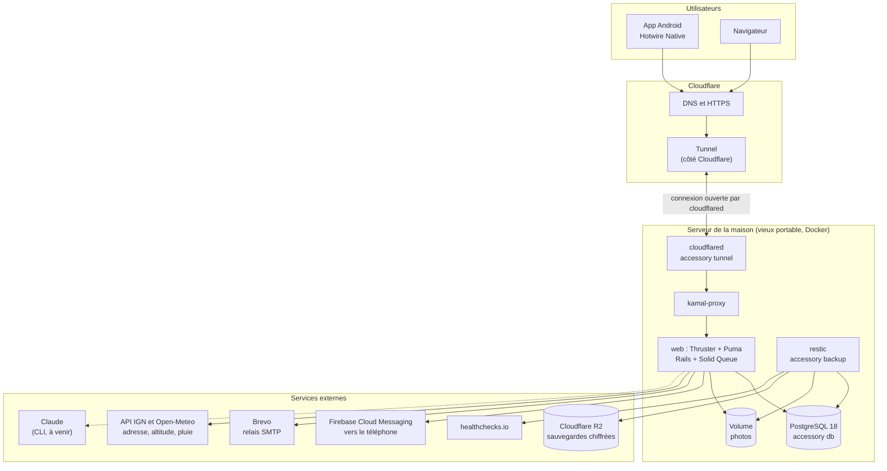
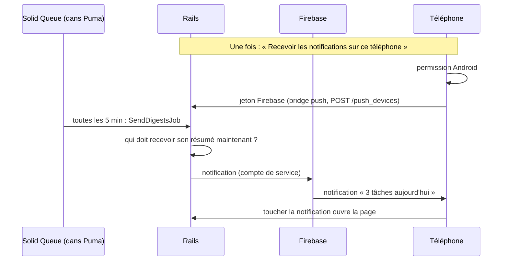
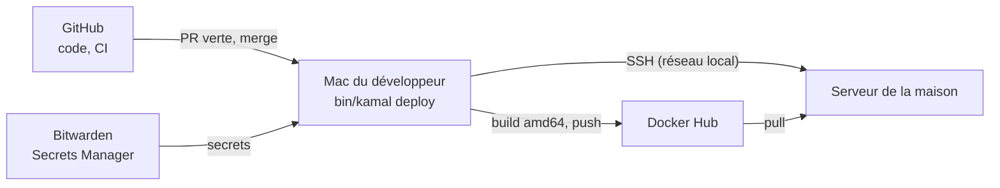

# Infrastructure

Tout ce qui fait tourner Easy Home, du téléphone aux sauvegardes : les machines, les services externes, les flux et
les secrets. L'organisation du code est dans `docs/architecture.md` ; les choix sont justifiés dans les ADR
(`docs/decisions/`).

Aucun domaine, aucune adresse IP ni aucune valeur secrète ici : le dépôt est public. Les noms des secrets suffisent à
savoir où chercher.

## Vue d'ensemble



- **Aucun port ouvert sur la box** : `cloudflared` ouvre une connexion **sortante** vers Cloudflare, qui y fait passer
  les requêtes. `kamal-proxy` ne publie aucun port sur le serveur (`proxy.run.publish: false`).
- **HTTPS** est assuré par Cloudflare ; le dernier saut, `cloudflared` → `kamal-proxy`, reste dans le réseau Docker
  `kamal`. Rails le sait (`assume_ssl`, `force_ssl`), et Cloudflare redirige `http://` vers `https://`.
- **Les jobs** (Solid Queue) tournent dans le processus Puma (`SOLID_QUEUE_IN_PUMA`) : pas de worker séparé, pas de
  Redis. Cache et WebSockets passent aussi par PostgreSQL (Solid Cache, Solid Cable).

## Le serveur

Un ancien ordinateur portable sous Linux, couvercle fermé, sur le réseau de la maison. Il peut faire tourner d'autres
services : Easy Home ne partage rien avec eux, ni réseau Docker, ni tunnel, ni base.

| Conteneur | Image | Rôle |
|---|---|---|
| `easy_home-web-<version>` | `lvcode/easy-home` (Docker Hub, privée) | L'app : Thruster (compression, cache des assets), Puma, Rails, Solid Queue |
| `kamal-proxy` | `basecamp/kamal-proxy` | Aiguille vers la bonne version de l'app, déploiement sans coupure |
| `easy_home-db` | `postgres:18` | 4 bases : l'app, le cache, la file des jobs, Action Cable |
| `easy_home-tunnel` | `cloudflare/cloudflared` (version figée) | Le tunnel vers Cloudflare, propre à Easy Home |
| `easy_home-backup` | `lvcode/easy-home-backup` (Docker Hub, publique) | Sauvegarde chaque nuit, `backup/` du dépôt |

Données sur le disque du serveur : le volume `easy_home_storage` (photos, ADR 0011) et le dossier de PostgreSQL. Les
deux sont sauvegardés (voir plus bas).

## Les services externes

| Service | Sert à | Si il tombe | Coût |
|---|---|---|---|
| Cloudflare (DNS, tunnel, HTTPS) | Rendre l'app joignable de partout | L'app est injoignable | Gratuit |
| Firebase Cloud Messaging | Notifications sur Android (ADR 0012) | Pas de notification ; l'app marche | Gratuit |
| Brevo | E-mails : mot de passe oublié (ADR 0018) | Pas d'e-mail ; le job échoue, visible dans Solid Queue | Gratuit (300 / jour) |
| API IGN (Géoplateforme) | Adresse de la maison, autocomplétion (ADR 0009) | Saisie de l'adresse impossible | Gratuit |
| Open-Meteo | Altitude (ADR 0009), pluie du jour (ADR 0015) | La pluie ne compte pas comme arrosage ce jour-là | Gratuit |
| Claude (CLI `claude -p`) | Analyse des photos de plantes (ADR 0008) | L'analyse échoue avec un message ; le reste marche | Forfait Claude |
| Cloudflare R2 | Sauvegardes chiffrées | Plus de sauvegarde ; l'app marche | Gratuit (10 Go) |
| healthchecks.io | Alerte si la sauvegarde de la nuit n'a pas eu lieu | Plus d'alerte | Gratuit |
| Docker Hub | Images de l'app (privée) et de la sauvegarde (publique) | Déploiement impossible | Gratuit |
| GitHub | Code, CI, Dependabot | CI et revue impossibles | Gratuit |

Le CLI `claude` n'est pas encore dans l'image de production : les analyses y échouent proprement en attendant.

## Une notification, de bout en bout



Les tâches récurrentes sont dans `config/recurring.yml` : résumés et rappels toutes les 5 minutes, échéances
manquées chaque heure, pluie chaque soir à 22 h.

## Déployer



1. Une PR passe la CI GitHub (secrets, sécurité, lint, tests, build Android), puis elle est mergée dans `main`.
2. Depuis `main` à jour, sur le Mac, `bin/kamal deploy` : Kamal construit l'image **depuis le dernier commit**
   (les changements non commités n'y sont pas), la pousse sur Docker Hub, puis, par SSH, la fait tirer au serveur et
   bascule `kamal-proxy` sur la nouvelle version une fois `/up` en bonne santé. Les migrations passent au démarrage
   (`db:prepare`).
3. Les accessories ne bougent pas avec `deploy` : `bin/kamal accessory reboot <nom>` pour les recréer.

L'image de sauvegarde se construit à part, taguée par l'empreinte du dossier `backup/`
(`git rev-parse --short=12 HEAD:backup`) : on ne la republie que quand son contenu change.

## Les secrets

Les valeurs ne sont jamais dans le dépôt. Trois endroits :

| Où | Quoi |
|---|---|
| Bitwarden Secrets Manager, lu par `.kamal/secrets` | `RAILS_MASTER_KEY` (clé des credentials de production), `KAMAL_REGISTRY_PASSWORD`, `POSTGRES_USER`, `POSTGRES_PASSWORD`, `TUNNEL_TOKEN`, `SMTP_USERNAME`, `SMTP_PASSWORD`, `RESTIC_REPOSITORY`, `RESTIC_PASSWORD`, `R2_ACCESS_KEY_ID`, `R2_SECRET_ACCESS_KEY`, `BACKUP_HEALTHCHECK_URL` |
| Credentials Rails chiffrées (`config/credentials/*.yml.enc`, versionnées) | `secret_key_base`, compte de service Firebase (`action_push_native.fcm`) |
| Fichiers locaux du Mac, jamais versionnés | `config/application.yml` (`APP_HOST`, `KAMAL_HOST`, `KAMAL_SSH_USER`, `MAIL_FROM`), `config/credentials/*.key`, `android/local.properties` (adresse de production, clé de signature de l'app), `android/app/google-services.json`, la clé de signature Android elle-même |

`BWS_ACCESS_TOKEN` (accès à Bitwarden) vit dans le shell du Mac. Les deux pertes irréparables : `RESTIC_PASSWORD`
(sauvegardes illisibles) et la clé de signature Android (l'app ne se met plus à jour sans être désinstallée) ; les deux
ont une copie hors du Mac.

## Les sauvegardes

Chaque nuit à 3 h (heure de La Réunion), l'accessory `backup` :

1. sauvegarde la base de l'app (`pg_dump`, puis restic) ; un échec de `pg_dump` n'enregistre rien ;
2. sauvegarde les photos ;
3. applique la rétention (7 jours, 5 semaines, 12 mois) et vérifie le dépôt (`restic check`) ;
4. prévient healthchecks.io. Sans signal, c'est healthchecks.io qui envoie une alerte : une sauvegarde qui n'a pas eu
   lieu (serveur éteint, conteneur arrêté) se voit aussi.

Tout est chiffré **avant** l'envoi : Cloudflare ne peut pas lire les sauvegardes. Les bases cache, file et Action Cable
ne sont pas sauvegardées : elles se recréent.

Restaurer, dans une base à part, sans toucher à la production :

```bash
bin/kamal accessory exec backup --reuse --interactive bash
createdb restore_check
restic dump --tag db latest easy_home.dump | pg_restore --no-owner --exit-on-error -d restore_check
```

Limite connue : le serveur peut effacer ses propres sauvegardes (jeton R2 en lecture et écriture).

## L'app Android

Deux apps côte à côte sur le téléphone : la version de test (`app.easyhome.android.debug`, « Easy Home (dev) »), qui
parle au serveur de dev du Mac par le câble USB, et la version de production (`app.easyhome.android`), signée, qui
parle au serveur de la maison. Détails : `docs/android-coque.md` et `docs/hotwire-native.md`.

## Pièges déjà rencontrés

- **DNS et Brevo** : la configuration automatique de Brevo crée des enregistrements NS qui délèguent tout le
  sous-domaine, et l'app devient injoignable. Toujours la configuration manuelle (TXT, CNAME), sur un domaine
  d'expédition sans CNAME (ADR 0018).
- **macOS et le réseau local** : sans l'autorisation « Réseau local » du terminal, Kamal (Ruby) échoue avec
  `No route to host` alors que `ssh` marche.
- **`pg_dump`** : celui de l'image de l'app est en version 17 et refuse un serveur 18. La sauvegarde utilise l'image
  `postgres:18`.
- **Assets précompilés en local** : un `public/assets` laissé par un `assets:precompile` est servi à la place du CSS à
  jour, en dev comme en test. À supprimer après usage.